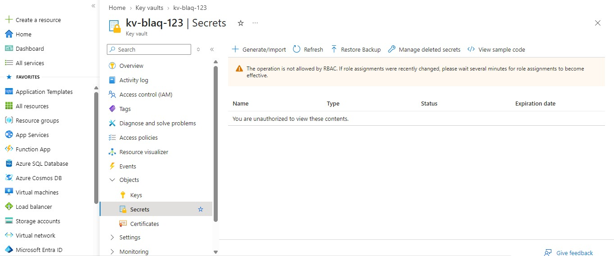
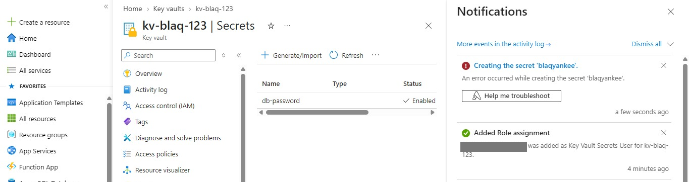
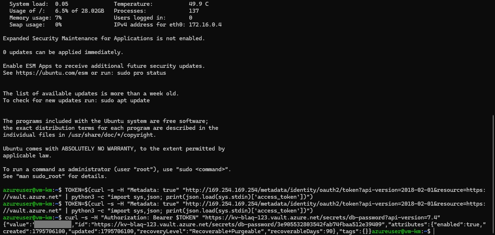

# Azure Key Vault Lab: RBAC and Managed Identity

Hands-on lab exploring how Azure Key Vault controls access to secrets, and how an Azure VM can read a secret without any stored credentials.

## What I built
- Resource group `rg-kv` containing Key Vault `kv-blaq-123` (Azure RBAC permission model)
- A secret named `db-password`
- An Ubuntu 24.04 VM with a system-assigned managed identity

## Steps
1. Created the Key Vault using the Azure RBAC permission model
2. Assigned myself **Key Vault Secrets Officer**, created a secret, and read it back
3. Removed my role and confirmed access was denied
4. Assigned **Key Vault Secrets User** and confirmed I could read the secret but not create a new one
5. Created a VM with a system-assigned managed identity and gave that identity **Key Vault Secrets User** on the vault
6. SSH'd into the VM, requested a token from the instance metadata service, and called the Key Vault REST API with `curl`

## Commands run on the VM
```bash
# Get an access token for Key Vault using the VM's managed identity
TOKEN=$(curl -s -H "Metadata: true" "http://169.254.169.254/metadata/identity/oauth2/token?api-version=2018-02-01&resource=https://vault.azure.net" | python3 -c "import sys,json; print(json.load(sys.stdin)['access_token'])")

# Read the secret
curl -s -H "Authorization: Bearer $TOKEN" "https://kv-blaq-123.vault.azure.net/secrets/db-password?api-version=7.4"
```

## What I learned
- Managing a vault and reading its secrets are separate permissions. Creating the vault did not give me access to its contents.
- Least privilege matters: Secrets User can read secrets, but only Secrets Officer can create them.
- Managed identities let a VM authenticate to Key Vault with no passwords or keys stored in code.

## Screenshots

**Access denied after removing my role**





**Creating a secret fails with the read-only role**





**VM reading the secret through its managed identity (value redacted)**





## Cleanup
Deleted the `rg-kv` resource group and purged the soft-deleted vault `kv-blaq-123` so no resources or costs remain.

## Security note
The secret shown is a demo value, and the screenshots have been redacted.
